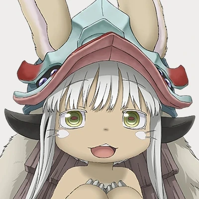

<p align="center">
  
</p>

<h1 align="center">Nanachi2.0</h1>

<p align="center">
  Telegram-бот для поиска аниме и скачивания видео с YouTube.
</p>

<p align="center">
  
  
  
  
</p>

# Nanachi2.0

**Nanachi2.0** — учебный Telegram-бот с микросервисной архитектурой на **Go** и **Python**. Первая версия позволяет искать аниме и получать карточки с информацией в Telegram, скачивать видео с YouTube **по прямой ссылке**, а также просматривать логи и статистику в административной веб-панели.

> **Статус:** первая версия (v1). Изображения ниже — **иллюстративные макеты интерфейсов**, а не скриншоты работающего приложения. Внешний вид и доступные поля могут отличаться от текущей реализации.

## Возможности

### 🎌 Поиск аниме

- Поиск аниме по названию через внешний API.
- Отображение результатов в виде карточек в Telegram.
- Вывод доступной информации об аниме (например, название, обложка, описание).

### 🎬 Скачивание видео с YouTube

- Приём ссылки на видео YouTube или YouTube Shorts.
- Загрузка и обработка видео отдельным Python-сервисом с `yt-dlp` и FFmpeg.
- Отправка результата пользователю в Telegram.
- Проверка допустимого формата URL и ограничения на размер и длительность видео.

**Важно:** поиск видео по названию не предусмотрен — нужна ссылка. Доступность скачивания зависит от YouTube, формата и ограничений Telegram.

### 🛠 Административная панель

- Просмотр событий и ошибок микросервисов.
- Просмотр информации о пользователях.
- Общая статистика использования.
- Авторизованный доступ к веб-интерфейсу.

## Стек технологий

| Технология | Назначение |
| --- | --- |
| Go | Telegram-бот, обработка команд и взаимодействие с API |
| Python + FastAPI | Микросервисы |
| yt-dlp + FFmpeg | Скачивание и обработка видео |
| SQLite | Данные административного сервиса и логи |
| Docker + Docker Compose | Контейнеризация и запуск |
| HTML / CSS / JavaScript | Административный веб-интерфейс |

## Архитектура

```text
Пользователь Telegram
        |
        v
Telegram Bot API
        |
        v
  Bot Service (Go)
        |
        +----> Anime Service (Python) ----> Внешний Anime API
        |
        +----> YouTube Service (Python) --> yt-dlp / FFmpeg
        |
        +----> Admin Service (Python) ----> SQLite (логи и статистика)
```

Сервисы разделены по функциям и взаимодействуют через HTTP API. Конкретные пути, имена контейнеров и переменные окружения определяются конфигурацией текущего проекта.

## Установка и запуск

### Требования

- Docker и Docker Compose.
- Токен Telegram-бота, созданного через [@BotFather](https://t.me/BotFather).
- Доступ к интернету для внешних API.

### 1. Клонирование

```bash
git clone https://github.com/Man0437/Nanachi2.0.git
cd Nanachi2.0
```

### 2. Настройка

Создайте `.env` согласно вашему `compose.yaml` или `docker-compose.yml`. Пример возможных переменных:

```dotenv
BOT_TOKEN=YOUR_TELEGRAM_BOT_TOKEN
ADMIN_USER=admin
ADMIN_PASSWORD=CHANGE_ME_TO_A_STRONG_PASSWORD
EVENT_TOKEN=GENERATE_A_RANDOM_SECRET
```

> Названия переменных приведены как пример: проверьте их по исходникам и конфигурации конкретной сборки. Не добавляйте `.env`, токены, cookies и пароли в Git.

### 3. Запуск

```bash
docker compose up -d --build
```

Проверить контейнеры и логи:

```bash
docker compose ps
docker compose logs -f
```

Остановить:

```bash
docker compose down
```

Адрес административной панели и опубликованный порт смотрите в Docker Compose.

## Использование

**Поиск аниме:** откройте бота, выберите поиск и введите название. Бот отправит карточки найденных тайтлов.

**Скачивание видео:** выберите загрузку с YouTube, отправьте HTTPS-ссылку и дождитесь результата в Telegram.

**Административная панель:** откройте веб-интерфейс, авторизуйтесь и просматривайте события, пользователей и статистику.
